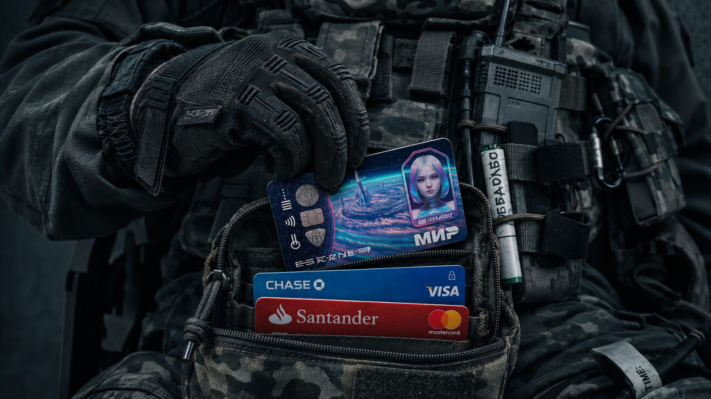

# Plastic Card



SPT 4.1.x server mod by **toortik**, version **2.0.0**.

Replaces the models and textures of roubles, dollars and euros with bank cards. Increases the maximum stack size to **2,147,483,646 units of currency**.

## Installation

With the game and server closed, download the ready-to-use ZIP from **Releases** and copy its `PlasticCard` folder into `SPT_Runtime/user/mods/` inside your SPT installation. Then start SPT normally.

```text
PlasticCard/
  PlasticCard.dll
  bundles.json
  bundles/Mods/
    roubles/rouble_magnet_card.bundle
    dollars/dollar_magnet_card.bundle
    euros/euro_magnet_card.bundle
```

## Build from source

Requirements: .NET SDK 10, Unity Editor 2022.3.43f1 with a valid license, and SPT 4.1.x server assemblies. Proprietary SPT/EFT assemblies are not included. Close the Unity project before running the batch build.

Supply the paths for your own installation. Replace `<UNITY_EDITOR_EXE>` with the full path to Unity 2022.3.43f1's `Unity.exe`, and `<SPT_RUNTIME_DIRECTORY>` with the full path to the `SPT_Runtime` folder inside your SPT installation.

```powershell
.\build.ps1 -UnityEditor '<UNITY_EDITOR_EXE>' -SptRuntimePath '<SPT_RUNTIME_DIRECTORY>'
```

The script builds the three Unity bundles, builds the server DLL, and assembles `dist/PlasticCard/`. Archive that folder for a release. Unity caches, build output and server DLLs are excluded from Git.

To build only the server DLL:

```powershell
dotnet build PlasticCard.csproj -c Release '-p:SptRuntimePath=<SPT_RUNTIME_DIRECTORY>'
```

## Editing textures and previews

Open `UnityAssetBundleProject` in Unity 2022.3.43f1. The atlases in `Assets/MagnetCard/` are `MagnetCardAlbedo.png` (RUB), `DollarCardAlbedo.png` (USD), and `EuroCardAlbedo.png` (EUR). Keep the 2048x2048 canvas and UV placement.

The **Plastic Card** menu provides live RUB and USD inspect preview windows. The preview saves `PreviewPivot.Icon.rotation`, which the bundle builders preserve. Camera perspective is 15 degrees; editor lighting may differ from EFT. `PlasticCardEuroSetup.PrepareAndBuild` prepares all currencies and builds their bundles.

## Known limitation

Dropped cards can settle below decorative floor debris or thin surface layers in some locations.

## Credits and licensing

The project's own source code is licensed under the [MIT License](LICENSE).

The MIT License applies to the project's own code only. The model, textures, images and logos are subject to their respective licenses and rights; see [THIRD_PARTY_NOTICES.md](THIRD_PARTY_NOTICES.md) and the original model readme.

